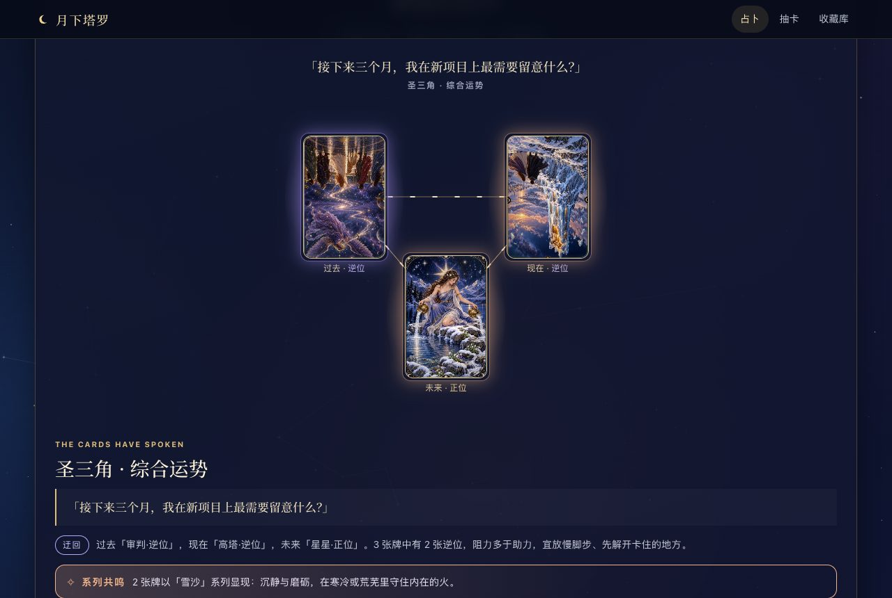
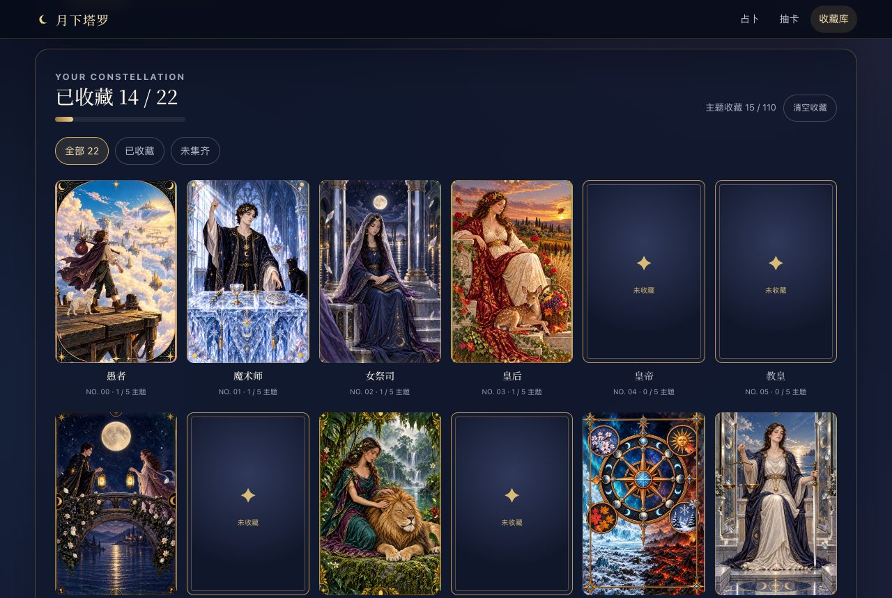
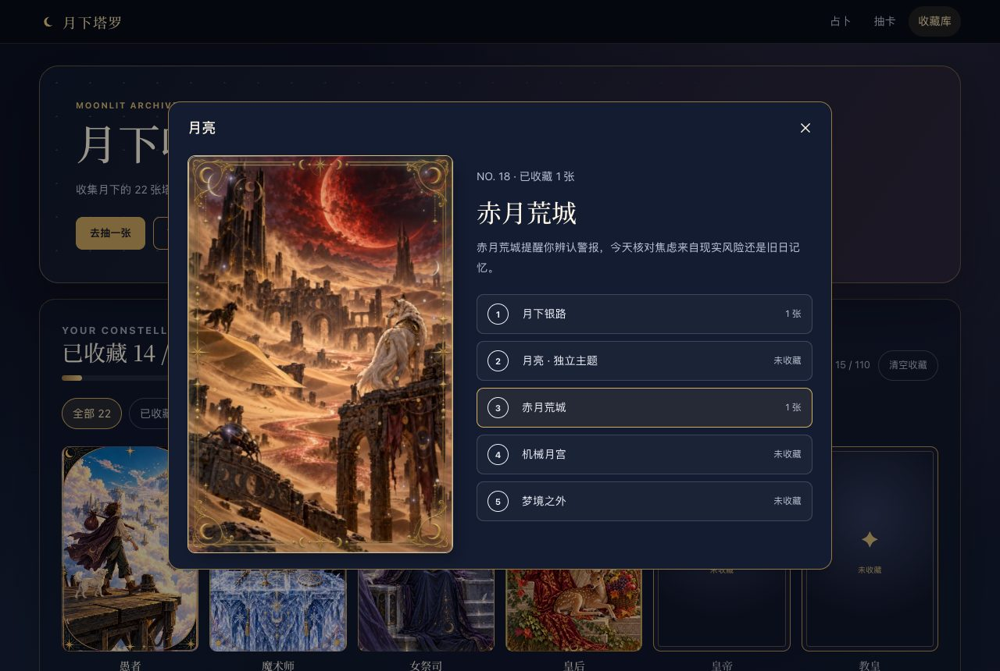
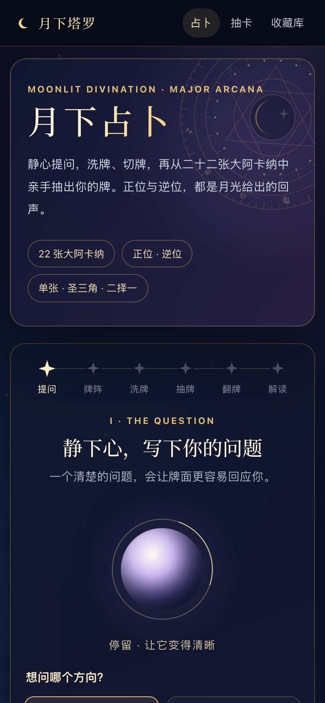

# Moonlit Tarot · 月下塔罗

[中文](README.md)

A front-end-only tarot reading and card collection site: write a question, shuffle, pick your own cards from the 22 Major Arcana, turn them over one by one, read the instant interpretation and save it as a report. There are also 110 theme cards (22 cards × 5 themes) to draw and collect.

No backend, account or API key is needed. Everything is stored in your own browser, `npm run dev` runs it, and the build deploys to any static host. The interface is in Chinese.



| Collection | Theme detail | Mobile |
| --- | --- | --- |
|  |  |  |

## Features

- **Divination ritual**: question → spread → shuffle → pick from a fanned deck → reveal → instant reading. Single-card, three-card triangle and two-option spreads; upright and reversed positions each have their own keywords, meaning and advice.
- **Theme resonance**: every drawn card manifests in one of five themes, and a theme that repeats within a spread produces a resonance note.
- **Reports**: turn a reading into a full report with an overview, per-card interpretation, synthesis, two-option comparison and suggested actions, kept in your reading archive.
- **Card draws and collection**: the 110 theme cards are drawn with equal odds and duplicates add to a count; the collection wall groups them by card, and each card face reacts to tilt with thickness and foil.
- **Accessible and responsive**: focus follows each step, every control works from the keyboard, and there is no horizontal scrolling on desktop, at 390px or at 320px.

## Getting started

Requires Node.js 18.17 or later.

```bash
npm install
```

```bash
npm run dev
```

```bash
npm run build
```

`build` runs the tests first and writes `dist/`. The app uses history-mode routing, so configure your host to fall back to `index.html`; asset paths assume the site root.

## Holographic flashcards (optional)

The repository only carries the covers and line art the app needs (about 30 MB). The full layered artwork and standalone 3D viewers for all 110 cards (about 760 MB) are published on [GitHub Releases](https://github.com/Shimmersss/moonlit-tarot/releases):

```bash
npm run fetch:flashcards
```

The script downloads the archive, checks its SHA-256, extracts it into `public/tarot/flashcards/` and verifies every file. Then open a path such as `/tarot/flashcards/v20261009/major-18/theme-01/index.html` to see a card in WebGL.

## Plugging in a backend

Pages read and write data only through `src/api/localStore.js`. Every function returns `Promise<{ data }>` and rejects with an error that carries `status`. To add account sync, server-side shuffling or AI readings, reimplement those functions against your own API with the same signatures; the pages need no changes. Card order, orientation and theme are fixed at shuffle time and picking only chooses a position — keep that rule on the server too.

## Art production records

`docs/art/` contains the production spec, per-card briefs, master and layer prompts, and the manifest and notes for each of the 110 theme slots (actual tool calls, input/output hashes and repair decisions). They are raw production records, written in Chinese; the source images, layered projects and review captures they mention are not included. See [docs/art/README.md](docs/art/README.md).

## License

- Source code: [MIT](LICENSE)
- Card art, theme cards, line art, flashcard assets and screenshots: [CC BY-NC-SA 4.0](LICENSE-ASSETS.md)
- Third-party components: [THIRD_PARTY_NOTICES.md](THIRD_PARTY_NOTICES.md)

The card faces were generated with AI image models and then curated and retouched; no copyrighted commercial deck imagery is used.

## Disclaimer

Tarot here offers a symbolic lens for entertainment and reflection. It is not prediction or diagnosis and is not medical, legal, psychological or financial advice.
